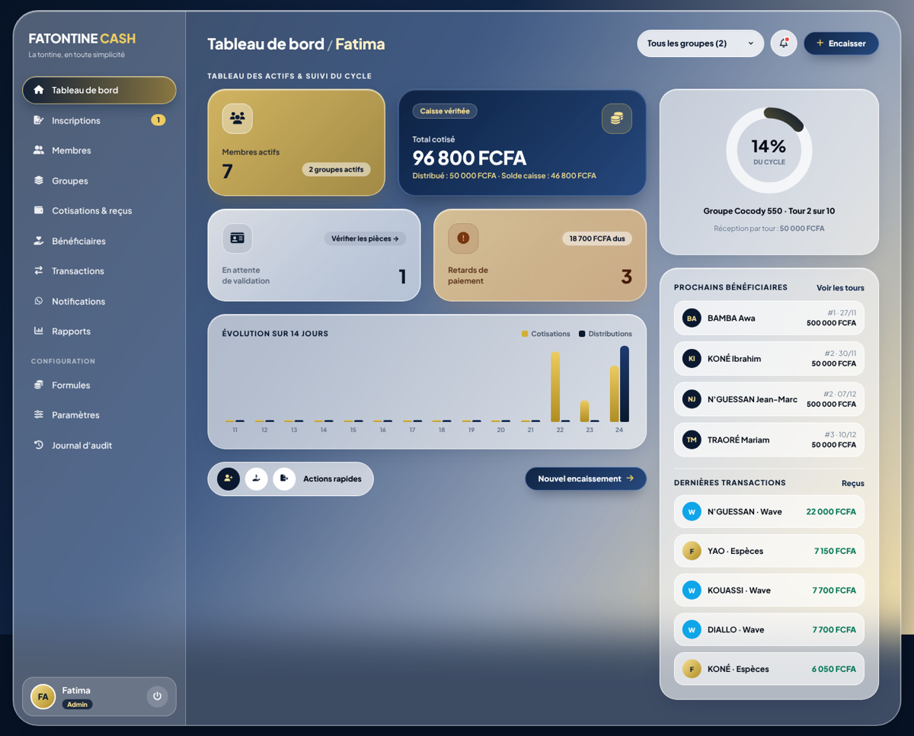
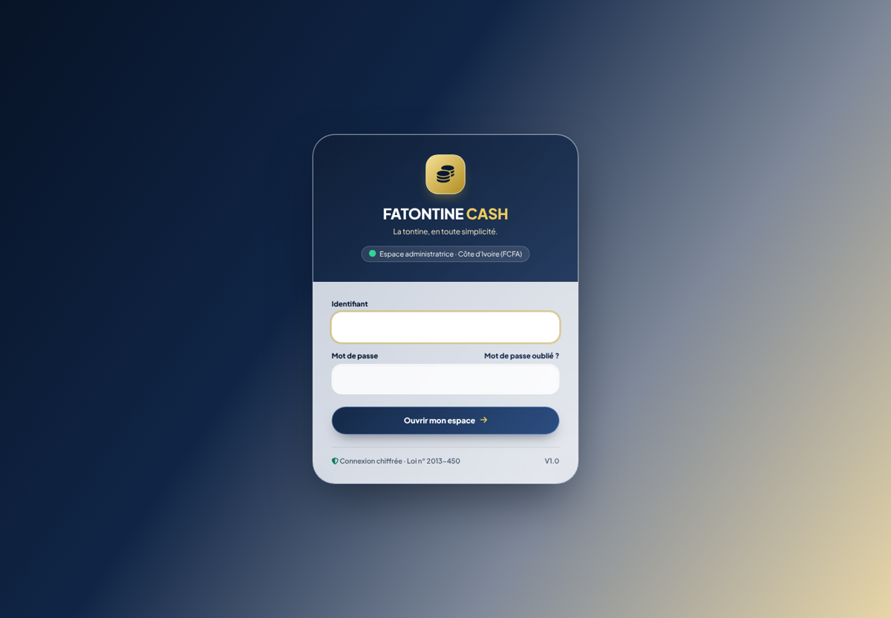
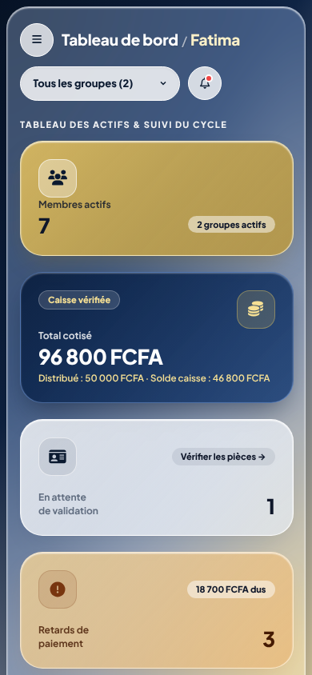
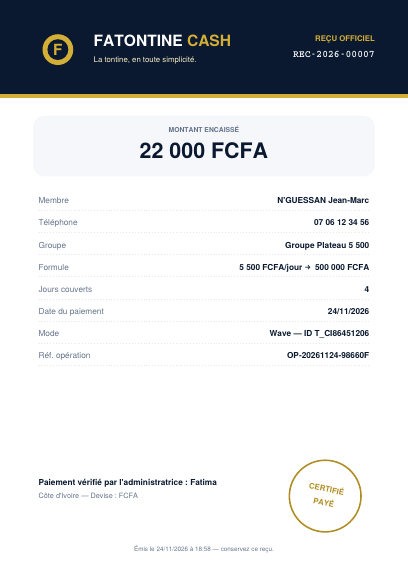

# FATONTINE CASH

**La tontine, en toute simplicité.** Plateforme web de gestion des tontines journalières pour la Côte d'Ivoire (FCFA), administrée par Fatima.

Django · PostgreSQL · design « Liquid Glass » (bleu nuit, or, blanc perle) · responsive ordinateur / tablette / téléphone.



| Connexion sécurisée | Mobile | Reçu PDF |
|---|---|---|
|  |  |  |

## Fonctionnalités (cahier des charges V1.0)

| § | Module | Ce qui est livré |
|---|---|---|
| 5.1 | Authentification | Connexion, mot de passe robuste (10 caractères minimum), blocage après 5 échecs pendant 15 min (par identifiant et par IP), réinitialisation par e-mail, déconnexion sécurisée, sessions de 8 h |
| 5.2 | Inscriptions | Formulaire complet (identité, CNI ou extrait, scan + photo, témoin, consentement ARTCI horodaté), statuts En attente / Validée / Refusée, **validation manuelle uniquement** |
| 5.3 | Membres | Fiche, modification tracée, pièces consultables, historique de paiement, attendu / versé / écart, suspension et clôture motivées |
| 5.4 | Groupes | Plusieurs groupes, nom, formule, date de démarrage, durée (10 × 10 jours), **10 places maximum contrôlées**, progression du cycle |
| 5.5 | Formules | Les 8 formules de l'affiche, modifiables, avec contrôle du calcul des frais de gestion |
| 5.6 | Cotisations | Versement d'un ou plusieurs jours, montant calculé automatiquement, référence unique `OP-…`, suivi des retards et des écarts |
| 5.7 | Bénéficiaires | Ordre de passage automatique, dates tous les 10 jours, remise (Wave ou espèces), confirmation de réception, **échange de rang avec justification obligatoire** |
| 5.8 | Transactions | Cotisations, distributions, dépenses autorisées, corrections. **ID Wave obligatoire et unique**, case « paiement vérifié » obligatoire, annulation sans suppression |
| 5.9 | Reçus | PDF avec logo, n° séquentiel `REC-2026-00001`, membre, montant, date, groupe, formule, référence, puis partage WhatsApp |
| 5.10 | Notifications | Rappels, retards, validations, refus, prochaines distributions : messages WhatsApp prêts à envoyer |
| 6 | Tableau de bord | Membres, groupes actifs, dossiers en attente, total cotisé / distribué / solde, retards, prochains bénéficiaires, dernières transactions, graphique sur 14 jours |
| 7 | Rapports | Journalier, hebdomadaire, mensuel, par groupe, historique individuel, retards, distributions, répertoire des membres, en **PDF et Excel** |
| 8 | Sécurité | HTTPS forcé (HSTS), pièces stockées hors du dossier web et servies uniquement à l'administratrice, contrôle du contenu des fichiers, journal d'audit, sauvegarde et restauration, purge des pièces selon une durée de conservation |

## Point financier à valider avec Fatima

Le cahier des charges (§13) indique que la réception vaut 90 % de la collecte. **Les calculs montrent autre chose** : pour un tour, 550 F × 10 membres × 10 jours = 55 000 F collectés pour 50 000 F reçus, soit **10/11 ≈ 90,91 %**. Les frais de gestion valent donc 1/11 de la collecte (5 000 F), c'est-à-dire **10 % du montant reçu**. La règle est la même pour les 8 formules.

La plateforme ne code en dur aucun taux : elle calcule la répartition à partir de chaque formule (page *Formules*). Voir [docs/SYNTHESE.md](docs/SYNTHESE.md).

## Démarrage local

```bash
python -m venv .venv && source .venv/bin/activate      # Windows : .venv\Scripts\activate
pip install -r requirements.txt
cp .env.example .env        # puis mettre DJANGO_DEBUG=1 et retirer DATABASE_URL pour utiliser SQLite
python manage.py migrate
python manage.py init_fatontine --email fatima@exemple.ci   # 8 formules + compte de Fatima
python manage.py runserver
```

Ouvrir http://127.0.0.1:8000. L'identifiant par défaut est `fatima`, et le mot de passe est celui que vous avez saisi.

## Tests

```bash
DJANGO_DEBUG=1 python manage.py test tontine
```

13 tests couvrent le parcours complet : inscription, validation, limite de 10 places, cotisation Wave, unicité de l'ID Wave, refus des paiements non vérifiés, annulation, échange de rang, distribution, pièces privées, blocage de connexion et exports PDF/Excel.

## Production

Voir **[docs/DEPLOIEMENT.md](docs/DEPLOIEMENT.md)** : serveur Linux + PostgreSQL + Nginx + certificat SSL, ou Docker Compose. Ce guide couvre aussi les sauvegardes automatiques et la restauration.

## Commandes utiles

| Commande | Rôle |
|---|---|
| `python manage.py init_fatontine --email …` | Formules officielles + compte administratrice |
| `python manage.py sauvegarde --garder 30` | Sauvegarde JSON compressée et horodatée (à lancer chaque nuit) |
| `python manage.py loaddata <fichier.json.gz>` | Restauration |
| `python manage.py purger_pieces [--simulation]` | Applique la durée de conservation des pièces |

## Structure

```
config/          réglages Django (variables d'environnement, sécurité HTTPS)
tontine/
  models.py      données : formules, groupes, inscriptions, membres, cotisations, tours, mouvements, audit
  services.py    règles métier (validation, cotisation, annulation, échange de rang, distribution, retards, WhatsApp)
  views.py       écrans
  pdf.py         reçus et rapports PDF (ReportLab)
  exports.py     rapports et Excel (openpyxl)
  templates/     interface Liquid Glass
  static/        CSS, polices et icônes hébergées localement (aucun CDN)
docs/            synthèse produit, déploiement, captures
```

## Évolutions prévues (§11)
Espace membre, notifications WhatsApp automatiques (API WhatsApp Business), API Wave, application Android, plusieurs administratrices, version commercialisable (multi-organisatrices).

---
Polices et icônes : Plus Jakarta Sans (SIL OFL 1.1), Font Awesome Free 6.5 (CC BY 4.0 / SIL OFL / MIT).
